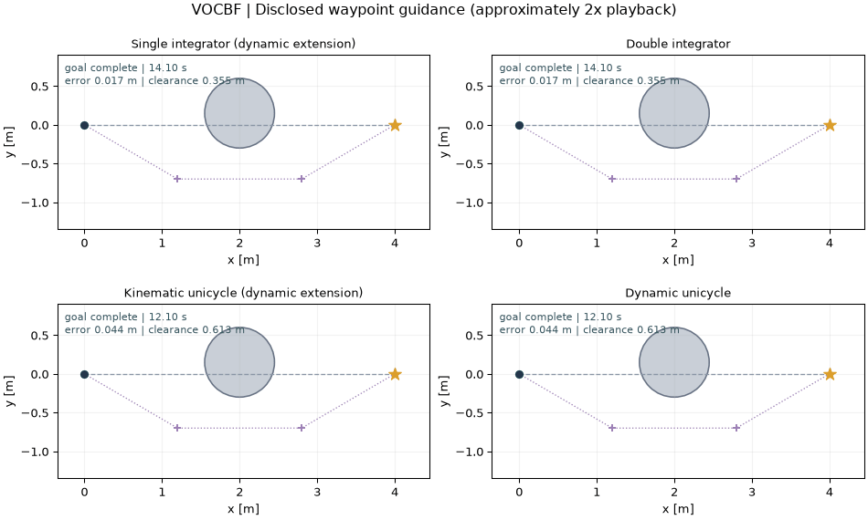
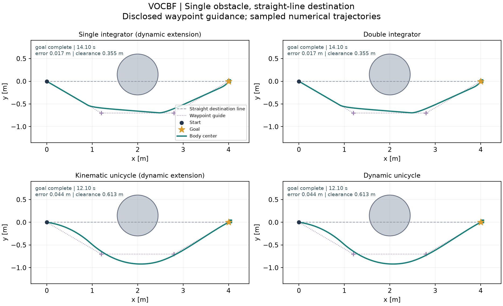
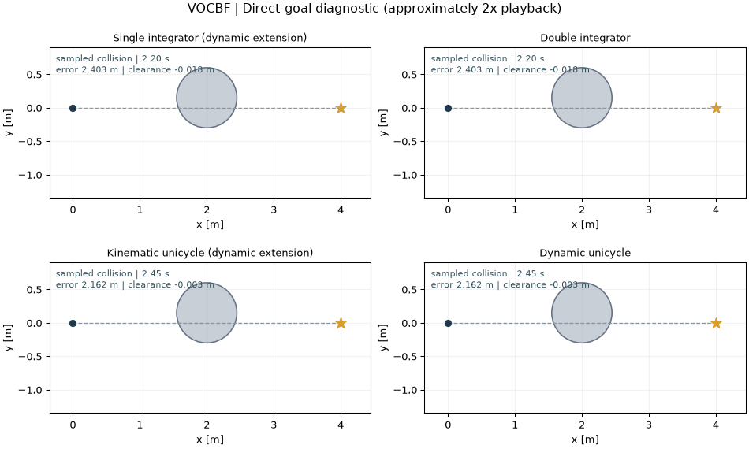
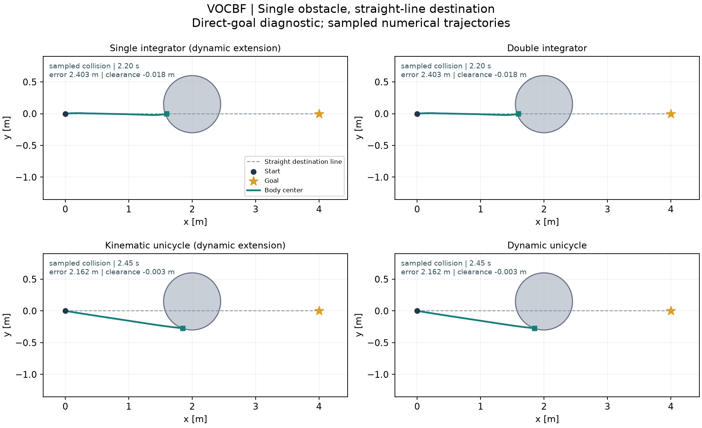

# VOCBF-Python

Standalone Python reproduction and clearly separated model extensions for **Dynamic Collision Avoidance Using Velocity Obstacle-Based Control Barrier Functions** by Jihao Huang, Jun Zeng, Xuemin Chi, Koushil Sreenath, Zhitao Liu, Hongye Su. [Original paper](https://arxiv.org/html/2503.00606v2). This is a community research implementation, not an official author repository.

[中文说明](README_ZH.md) · [Model contracts](docs/MODEL_SCOPE.md) · [Results](docs/RESULTS.md) · [Source and licensing](THIRD_PARTY_NOTICES.md)

## Reproduction scope

Independent implementation of the paper equations on the original five-state acceleration-controlled unicycle, including the four CLFs, literal principal arctan chart, moving-obstacle derivative, soft slacks and side disjunctions. No verified author implementation or exact author-figure reproduction is claimed. Unspecified cost weights/gains and example geometry are declared.

The double integrator uses the same VO half-space geometry with Cartesian CLFs. First-order plants use an explicit dynamic extension: filter acceleration drives continuously ramped velocity commands. Their closed-loop state is augmented; they are not a direct first-order VOCBF theorem or a zero-order-held velocity controller.

## Install and run

Python 3.12 is the locally tested runtime. Public model examples are self-contained and need no sibling repository, original research workspace or MATLAB installation.

```sh
python3.12 -m venv .venv
source .venv/bin/activate
python -m pip install -r requirements-tested.txt
python -m pip install -e .
```

## Single-obstacle demo

### Scenario

The controlled body center starts at `(0, 0)` m and the final goal is `(4, 0)` m. One obstacle at `(2, 0.15)` m with **inflated exclusion radius `0.45 m`** blocks the direct start–goal line. This radius already includes the chosen body-size/clearance allowance. Unicycles start facing +x with a 0.15 m center offset; second-order states start at rest. The slight lateral obstacle offset breaks exact symmetry. “Straight-goal” describes the start–goal line; the actual reference targets depend on the navigation configuration below.

### Navigation and waypoint usage

**Waypoint navigation: used by all four models.** Two manually specified intermediate targets choose the passing side before the final goal. VOCBF uses its existing equations and default settings to track these reference targets.

| Models | Waypoint navigation | Intermediate targets (m) | Switching rule |
|---|---|---|---|
| All four models | Yes — 2 waypoints | `(1.2, -0.7)` → `(2.8, -0.7)` | Active from the first step; advance when distance to current waypoint `< 0.35 m`, then target `(4, 0)` |

The waypoints are fixed navigation inputs supplied by this demo, not outputs generated by the CBF controller. The displayed successes include that navigation layer; the direct-goal diagnostic below shows what happens when it is disabled.

### Animation

**Navigation shown: all four models use waypoint navigation.**



### Trajectories



### Results

| Model | Waypoint navigation | Outcome | Time (s) | Final error (m) | Min. sampled clearance (m) | Fallbacks |
|---|---|---|---:|---:|---:|---:|
| Single integrator + dynamic extension | **Yes** | `goal_complete` | 14.10 | 0.01689 | 0.35506 | 0 |
| Double integrator | **Yes** | `goal_complete` | 14.10 | 0.01689 | 0.35506 | 0 |
| Kinematic unicycle + dynamic extension | **Yes** | `goal_complete` | 12.10 | 0.04419 | 0.61268 | 0 |
| Dynamic unicycle | **Yes** | `goal_complete` | 12.10 | 0.04419 | 0.61268 | 0 |

[Summary, parameters and source hashes](evidence/single_obstacle/summary.json) · [Per-model states, controls and solver events](evidence/single_obstacle/)

### Reproduce the demo

```sh
python -m vocbf demo --output runs/single_obstacle
python -m vocbf demo --model dynamic_unicycle --output runs/single_obstacle_dynamic
python examples/single_obstacle/run.py --output runs/single_obstacle_example
```

The first command runs all four models; the second runs one model. All commands save PNG, GIF, NPZ and JSON results. Add `--no-animation` to skip GIF rendering. Use a fresh output folder for each run; existing results are protected. Timeout, infeasibility and sampled-collision outcomes are retained in `summary.json`; inspect the recorded outcome to determine task completion.

### Parameters and limitations

The demo uses `dt=0.05 s`, default model/controller parameters, and a 60 s limit. The single integrator and kinematic unicycle use an explicit dynamic extension: the filter produces acceleration and the first-order plant receives continuously ramped velocity commands. Their augmented trajectories match the corresponding second-order model. The parameter record separates constructor configuration from effective QP configuration: Cartesian CLF weights are `[100, 1]`; unicycle CLF weights are `[100, 100, 1, 1]`. No nominal fallback is used.

Completion requires body-center goal error below `0.15 m` plus the [model-specific stopping condition](docs/MODEL_SCOPE.md) at consecutive hold endpoints for `0.5 s`. Clearance is checked at 21 independent DOP853 samples per hold. Positive sampled clearance is numerical evidence, not a continuous-time safety proof. These are model-extension demos with disclosed navigation and controller settings, separate from original paper experiments and the earlier diagonal-goal fixtures. Different navigation and speed settings do not support a performance ranking.

### Direct-goal results (no waypoints)

**Waypoint navigation: disabled in all four models below.**

Only waypoint navigation is disabled here. Geometry, initial state, controller settings, demo-specific nominal tuning and dynamic extensions remain the same as in the default demo. These records are model-extension diagnostics, not original-paper benchmark results.

With waypoint navigation disabled, the same scene and default settings produce sampled collisions in all four models: minimum clearance `-0.01842 m` for the Cartesian pair and `-0.00280 m` for the unicycle pair. The [direct-goal diagnostic](evidence/single_obstacle/direct_goal_diagnostic.json) retains these failures. Guided completion does not establish direct-goal convergence or safety.

| Model | Waypoint navigation | Outcome | Time (s) | Final error (m) | Min. sampled clearance (m) | Fallbacks |
|---|---|---|---:|---:|---:|---:|
| Single integrator + dynamic extension | **No** | **`sampled_collision`** | 2.20 | 2.40319 | -0.01842 | 0 |
| Double integrator | **No** | **`sampled_collision`** | 2.20 | 2.40319 | -0.01842 | 0 |
| Kinematic unicycle + dynamic extension | **No** | **`sampled_collision`** | 2.45 | 2.16247 | -0.00280 | 0 |
| Dynamic unicycle | **No** | **`sampled_collision`** | 2.45 | 2.16247 | -0.00280 | 0 |

Time is the executed duration; a timeout or collision is not task completion. Near-zero clearance at numerical precision indicates contact with the inflated boundary, not a useful positive margin.





[No-waypoint summary and parameters](evidence/single_obstacle_direct/summary.json) · [Complete no-waypoint records](evidence/single_obstacle_direct/)

```sh
python -m vocbf demo --guidance direct --no-animation --output runs/single_obstacle_direct
```

## Original problem entry

```sh
# Use the environment above
python -m vocbf original --suite all --output runs/original
```

The VOCBF original entry runs static and constant-velocity moving-obstacle mechanisms on the paper model. Published physical parameters are retained; the article does not fully specify all figure parameters or cost matrices, so exact figure matching is not asserted.

## Other examples and verification

The `run` commands below execute the earlier diagonal-goal fixture; `demo` runs the single-obstacle fixture above. [Observed results](docs/RESULTS.md) retain prior failures and their source snapshots. Model equations, state/input ordering and example entry points are documented in [MODEL_SCOPE.md](docs/MODEL_SCOPE.md).

```sh
python -m unittest discover -s tests -v
python -m vocbf verify --output runs/verification.json
python -m vocbf run --model single_integrator --output runs/single_integrator
python -m vocbf run --model double_integrator --output runs/double_integrator
python -m vocbf run --model kinematic_unicycle --output runs/kinematic_unicycle
python -m vocbf run --model dynamic_unicycle --output runs/dynamic_unicycle
```

## Author and maintainer

Independent Python implementation, model extensions, demos and repository maintenance: **[Yo Kotaku (@youkoutaku)](https://github.com/youkoutaku)**. Original paper authors: **Jihao Huang, Jun Zeng, Xuemin Chi, Koushil Sreenath, Zhitao Liu, Hongye Su**. Cite the original paper when using the method; [CITATION.cff](CITATION.cff) records repository authorship separately.

## Publication preparation

```sh
python scripts/export_public.py --output dist/VOCBF-Python-public.zip
```

The archive uses an explicit source/documentation allowlist and includes a SHA256 manifest. It excludes `.venv`, `.upstream`, `.local-reference`, `runs`, Git internals and old archives. Choose a new filename if the target ZIP exists. CI configuration is supplied; remote execution remains untested until publication. This preparation creates no GitHub remote, release, commit or push.

## License and attribution

**MIT covers independent implementation and new code only.** Original paper attribution, retained third-party notices and redistribution exclusions are documented in [THIRD_PARTY_NOTICES.md](THIRD_PARTY_NOTICES.md) and [LICENSE_STATUS.md](LICENSE_STATUS.md). Repository authorship does not change upstream ownership or licensing.
