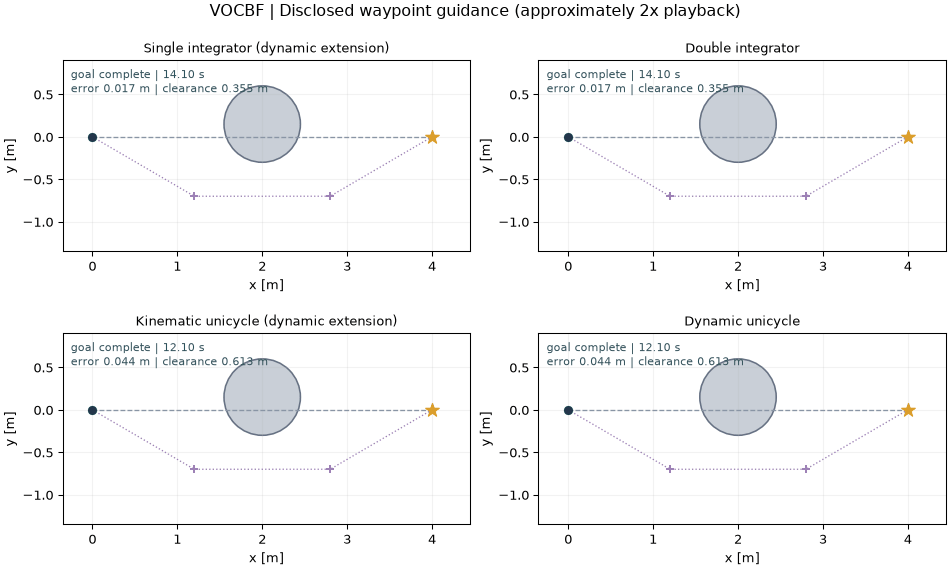
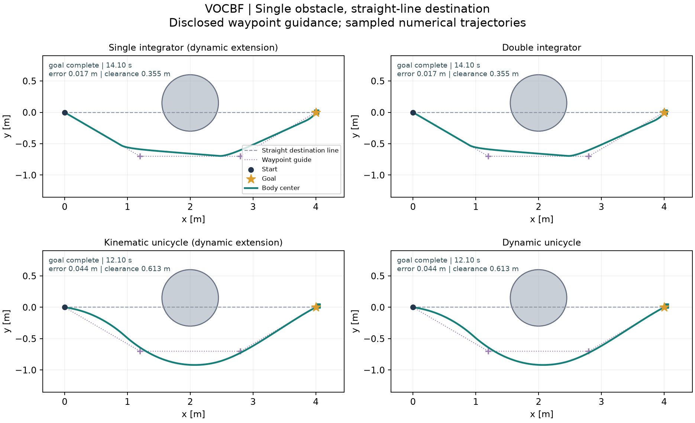
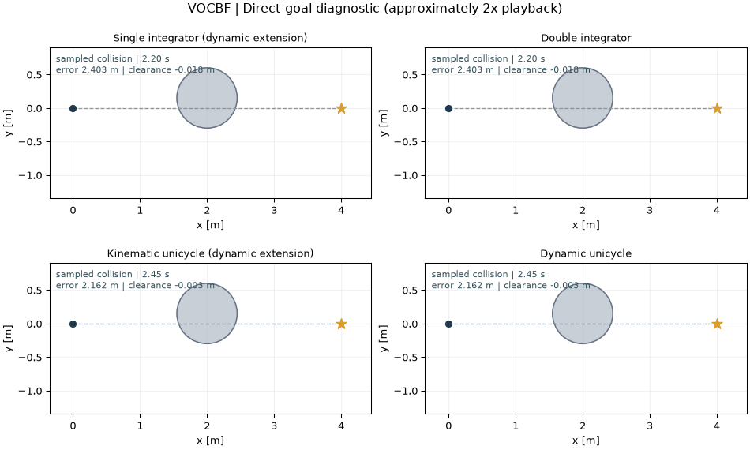
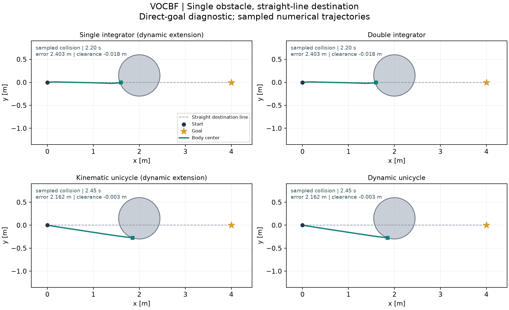

# VOCBF-Python 中文说明

本仓库依据 **[Dynamic Collision Avoidance Using Velocity Obstacle-Based Control Barrier Functions](https://arxiv.org/html/2503.00606v2)** 整理独立 Python 实现与明确区分的模型扩展。原论文作者：**Jihao Huang, Jun Zeng, Xuemin Chi, Koushil Sreenath, Zhitao Liu, Hongye Su**。这是社区研究实现，不是原作者官方仓库。

[English](README.md) · [模型说明](docs/MODEL_SCOPE.md) · [运行结果](docs/RESULTS.md) · [来源与许可](THIRD_PARTY_NOTICES.md)

## 复现范围

依据原文方程独立实现五状态加速度输入独轮车，包括四个 CLF、主值 arctan 坐标分支、移动障碍物导数、软松弛和左右侧析取。没有可核验的作者程序，不声称精确复现作者图像；原文未给出的权重、增益和几何均明确说明。

双积分器使用相同 VO 半空间几何及笛卡尔 CLF。一阶对象使用加速度滤波驱动连续速度斜坡的动态扩展，闭环状态被增广；不能视为直接的一阶 VOCBF 定理或零阶保持速度控制器。

## 安装与运行

本地验证使用 Python 3.12。公开模型示例可独立运行，不依赖兄弟仓库、原研究工作区或 MATLAB。

```sh
python3.12 -m venv .venv
source .venv/bin/activate
python -m pip install -r requirements-tested.txt
python -m pip install -e .
```

## 单障碍物 demo

### 场景

受控机体中心从 `(0, 0)` m 出发，最终目标为 `(4, 0)` m。障碍物中心为 `(2, 0.15)` m，**膨胀排斥半径为 `0.45 m`**，挡住起点到终点的直线；该半径已包含所选机器人尺寸/间隙裕量。独轮车初始朝向为 +x，机体中心偏置为 0.15 m；二阶状态从静止出发。障碍物的小幅横向偏移用于打破完全对称。“直线目标”描述起终点连线，实际参考目标取决于下面的导航配置。

### 导航与 waypoint 使用

**Waypoint 导航：四种模型全部使用。** 两个人工指定的中间目标选择绕行侧，再引导到终点；VOCBF 使用现有方程与默认配置跟踪这些参考目标。

| 模型 | Waypoint 导航 | 中间目标 (m) | 切换规则 |
|---|---|---|---|
| 全部四种模型 | 是，2 个航点 | `(1.2, -0.7)` → `(2.8, -0.7)` | 从第一步开始跟踪；距当前航点 `< 0.35 m` 时切换，最后跟踪 `(4, 0)` |

这些航点是 demo 人工给定的导航输入，不是 CBF 控制器自动生成的路径。图像与结果包含该导航层的作用；关闭导航后的真实结局见下方无航点诊断。

### 动画

**图中导航：四种模型全部使用 waypoint 导航。**



### 轨迹



### 实测结果

| 模型 | Waypoint 导航 | 实测结局 | 时间 (s) | 最终误差 (m) | 最小采样间隙 (m) | 回退次数 |
|---|---|---|---:|---:|---:|---:|
| 单积分器 + 动态扩展 | **是** | `goal_complete` | 14.10 | 0.01689 | 0.35506 | 0 |
| 双积分器 | **是** | `goal_complete` | 14.10 | 0.01689 | 0.35506 | 0 |
| 运动学独轮车 + 动态扩展 | **是** | `goal_complete` | 12.10 | 0.04419 | 0.61268 | 0 |
| 动力学独轮车 | **是** | `goal_complete` | 12.10 | 0.04419 | 0.61268 | 0 |

[汇总、参数与源码哈希](evidence/single_obstacle/summary.json) · [逐模型状态、控制与求解事件](evidence/single_obstacle/)

### 复现 demo

```sh
python -m vocbf demo --output runs/single_obstacle
python -m vocbf demo --model dynamic_unicycle --output runs/single_obstacle_dynamic
python examples/single_obstacle/run.py --output runs/single_obstacle_example
```

第一条命令运行全部四模型，第二条仅运行一个模型。命令输出 PNG、GIF、NPZ 和 JSON；加 `--no-animation` 可跳过 GIF。每次请使用新的输出目录，已有结果不会被覆盖。demo 超时、不可行或出现采样碰撞时会在 `summary.json` 中保留真实结局；任务是否完成以记录的 outcome 为准。

### 参数与适用边界

本 demo 使用 `dt=0.05 s`、默认模型/控制器参数和 60 s 时限。单积分器与运动学独轮车使用显式动态扩展：滤波器输出加速度，一阶对象接收连续变化的速度斜坡，增广轨迹与对应二阶模型一致。参数记录区分构造配置与实际 QP 配置：积分器 CLF 权重为 `[100, 1]`，独轮车为 `[100, 100, 1, 1]`。未使用名义回退。

完成判据是机体中心终点误差 `< 0.15 m`，并在连续控制周期末满足[各模型停止条件](docs/MODEL_SCOPE.md)，累计 `0.5 s`。每个保持区间用 DOP853 独立检查 21 个采样点；正采样间隙不构成连续时间安全证明。这些属于明确披露导航与控制配置的模型扩展示例，与原论文实验、旧斜向目标示例分别记录。不同导航与限速配置不能用于方法性能排名。

### 无 waypoint 的逐模型结果

**下方四种模型全部关闭 waypoint 导航。**

这里仅关闭 waypoint 导航；场景、初态、控制器参数、demo 专用名义跟踪调节及动态扩展保持不变。这些记录属于模型扩展诊断，不是原论文基准结果。

关闭 waypoint 导航后，相同场景与默认配置下四模型均出现采样碰撞：积分器两模型最小间隙为 `-0.01842 m`，独轮车两模型为 `-0.00280 m`。[无航点诊断](evidence/single_obstacle/direct_goal_diagnostic.json)保留这些失败结果。带引导完成不构成直接目标控制的收敛或安全保证。

| 模型 | Waypoint 导航 | 实测结局 | 时间 (s) | 最终误差 (m) | 最小采样间隙 (m) | 回退次数 |
|---|---|---|---:|---:|---:|---:|
| 单积分器 + 动态扩展 | **否** | **`sampled_collision`** | 2.20 | 2.40319 | -0.01842 | 0 |
| 双积分器 | **否** | **`sampled_collision`** | 2.20 | 2.40319 | -0.01842 | 0 |
| 运动学独轮车 + 动态扩展 | **否** | **`sampled_collision`** | 2.45 | 2.16247 | -0.00280 | 0 |
| 动力学独轮车 | **否** | **`sampled_collision`** | 2.45 | 2.16247 | -0.00280 | 0 |

表中时间是实际执行时长，超时或碰撞不代表任务完成。接近机器精度的零间隙表示处于膨胀边界附近，不能视为有效正安全裕量。





[无航点汇总与参数](evidence/single_obstacle_direct/summary.json) · [完整无航点记录](evidence/single_obstacle_direct/)

```sh
python -m vocbf demo --guidance direct --no-animation --output runs/single_obstacle_direct
```

## 原文问题入口

```sh
python -m vocbf original --suite all --output runs/original
```

原文入口在论文模型上执行静态与匀速移动障碍物机制案例。保留已公开物理参数；原文未完整指定全部绘图参数和代价矩阵，因此不声称逐图精确复现。

## 其他示例与验证

以下 `run` 命令运行旧斜向目标场景；`demo` 运行上面的单障碍物场景。[运行结果](docs/RESULTS.md)保留历史失败及其源码快照。模型方程、状态/输入顺序和四类示例入口见[模型说明](docs/MODEL_SCOPE.md)。

```sh
python -m unittest discover -s tests -v
python -m vocbf verify --output runs/verification.json
python -m vocbf run --model single_integrator --output runs/single_integrator
python -m vocbf run --model double_integrator --output runs/double_integrator
python -m vocbf run --model kinematic_unicycle --output runs/kinematic_unicycle
python -m vocbf run --model dynamic_unicycle --output runs/dynamic_unicycle
```

## 作者与维护者

独立 Python 实现、模型扩展、demo 与仓库维护：**[Yo Kotaku（@youkoutaku）](https://github.com/youkoutaku)**。原论文作者为 **Jihao Huang, Jun Zeng, Xuemin Chi, Koushil Sreenath, Zhitao Liu, Hongye Su**。使用方法时请引用原文；[CITATION.cff](CITATION.cff)单独记录仓库作者信息。

## 发布准备

```sh
python scripts/export_public.py --output dist/VOCBF-Python-public.zip
```

公开 ZIP 使用明确的源码/文档白名单，包含逐文件 SHA256 清单；排除 `.venv`、`.upstream`、`.local-reference`、`runs`、Git 内部文件及旧归档。若 ZIP 已存在，请换一个输出文件名。已提供 CI 配置，远端执行需在发布后验证。此准备过程不创建 GitHub 远端、Release、提交或推送。

## 许可与归属

**MIT 仅覆盖独立实现及新增代码。** 原论文归属、保留的第三方声明和再分发排除项见[第三方说明](THIRD_PARTY_NOTICES.md)与[许可状态](LICENSE_STATUS.md)。仓库作者信息不改变上游版权与许可范围。
