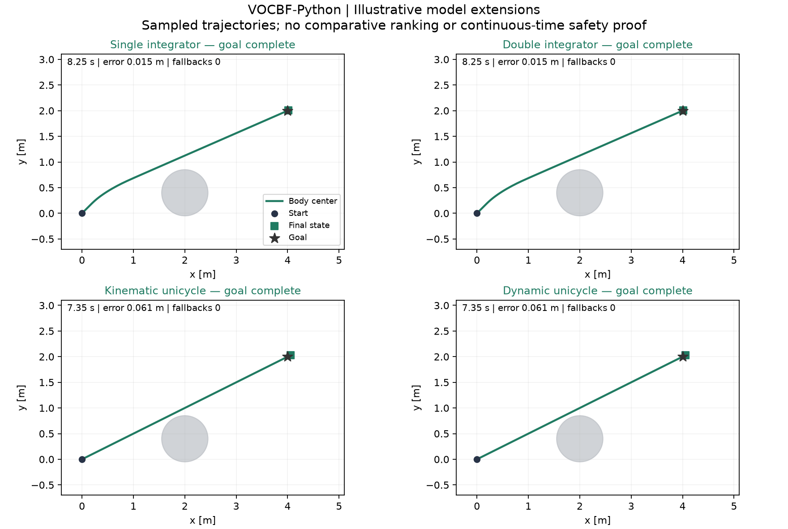

# Locally observed results

| Model | Outcome | Steps | Final goal error (m) | Minimum sampled clearance (m) | Nominal fallbacks |
|---|---|---:|---:|---:|---:|
| single_integrator | goal_complete | 165 | 0.0147054 | 0.213638 | 0 |
| double_integrator | goal_complete | 165 | 0.0147054 | 0.213638 | 0 |
| kinematic_unicycle | goal_complete | 147 | 0.0608146 | 0.0866566 | 0 |
| dynamic_unicycle | goal_complete | 147 | 0.0608146 | 0.0866566 | 0 |

These are one illustrative fixture per model. Timeouts and nominal fallback counts are retained. Positive sampled clearance is not a continuous-time safety proof. No comparison ranking is inferred.

[Equation/solver checks](../evidence/current_equation_verification.json) · [Original execution](../evidence/current_original_execution.json) · [Run data and source hashes](../evidence/current_model_runs.json) · [Actual wheel installed in an independent environment](../evidence/public_wheel_verification.json)

Numerical states, inputs and solver events for every example are bundled under [evidence/examples](../evidence/examples/). Regenerate this figure with `python scripts/plot_results.py`.

The two original-model static/moving mechanisms retained negative design clearance (-0.001512 m and -0.003613 m respectively). Exact figure reproduction remains unclaimed. The two first-order demos run explicit dynamic extensions, so their trajectories match the corresponding second-order example by construction.

## Straight-line destination / single-obstacle fixture

The new [four-model demo and result table](../README.md#single-obstacle-demo) uses a common straight-line destination, one blocking disk and explicitly disclosed waypoint guidance. All four guided model runs settle at the goal. [Numerical data, GIF and figures](../evidence/single_obstacle/) include the [direct-goal failure diagnostic](../evidence/single_obstacle/direct_goal_diagnostic.json). These are separate from the older diagonal-goal example above; original outcomes are retained.

The existing `current_model_runs.json` is a historical execution snapshot for the older diagonal-goal examples. Its source hashes are retained, including the pre-demo CLI hash; the additive `demo` command has its own current source hashes in `evidence/single_obstacle/summary.json`. The controller equations, models and legacy simulation entry are unchanged.
